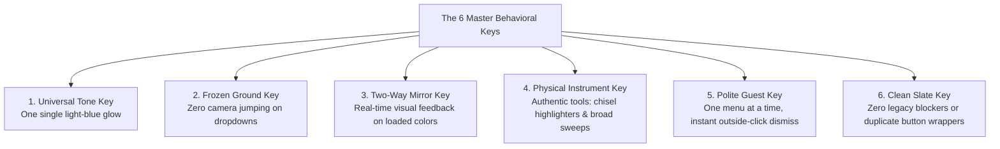

# 🛡️ The Great Patch — Master Architectural & Behavioural Blueprint

> **Document Purpose:** Detailed master plan to install the core **Behavioural Keys (Master Switches)** into the Notes App engine, eliminating recurring visual bugs and ensuring that future design and layout changes reflect seamlessly across the entire app.

---

## 🧭 1. The Core Problem: Why Theory Didn't Match Reality

Until now, our codebase was modular in **where files are kept** (split into clean CSS and JS files), but it was not yet modular in **how interactive behaviors are enforced**. 
* When the "Navigate" button was styled, it was given one shade of blue.
* When the "Home" tab was styled, it was given another shade of blue.
* When the Font Color button was upgraded, an old hidden layout rule from weeks ago stayed behind in the room, forcing the arrow to the bottom and blocking clicks.
* When dropdowns were opened, the browser executed its own built-in auto-scroll behavior because no master law commanded it to freeze.

**The Great Patch changes this fundamentally.** Instead of patching individual rooms, we install **Master Behavioral Switches** at the foundation.

---

## 🔑 2. The Master Behavioral Switches (The Foundation)

We install 6 universal rules that govern the entire app:

---

## 🔍 3. Intelligent Bug Classification

Here is the exact breakdown of the reported bugs, showing which ones will **settle automatically** once the Master Switches are flipped, and which require **specific craftsmanship**:

| Reported Bug | Category | Resolution Mechanism |
| :--- | :--- | :--- |
| **Two Different Blue Tones** (Dark Blue vs Light Blue) | ⚡ **Settles Automatically** | Handled by **Master Key 1 (Universal Tone)**. All active buttons and tabs link to a single light-blue token. |
| **Dropdown Scroll-Up Jump** (Font, Size, and Type) | ⚡ **Settles Automatically** | Handled by **Master Key 2 (Frozen Ground)**. Locks camera viewport during dropdown interaction. |
| **Font Color Button Clicks Blocked & Arrow on Bottom** | ⚡ **Settles Automatically** | Handled by **Master Key 6 (Clean Slate)**. Removes old legacy container rules and aligns arrow horizontally on the right. |
| **No Clue Which Color is Selected** (Missing Feedback) | ⚡ **Settles Automatically** | Handled by **Master Key 3 (Two-Way Mirror)**. Auto-binds glowing rings on active swatches and live indicator bars on buttons. |
| **Overlapping Menus** (Highlighter vs Font Color) | ⚡ **Settles Automatically** | Handled by **Master Key 5 (Polite Guest)**. Centralized dismiss handler closes other palettes immediately. |
| **Archaic Ink Mode Icons** (Emoji glyphs) | 🎨 **Specific Craftsmanship** | Requires designing modern vector SVGs for Pen, Highlighter, and Eraser. |
| **Round Highlighter Tip** (Unrealistic shape) | 🎨 **Specific Craftsmanship** | Requires designing an angled, slanted chisel-nib graphic for the highlighter preview. |
| **Highlighter Width Too Thin** (Needs more breadth) | 🎨 **Specific Craftsmanship** | Requires adjusting stroke breadth multiplier in the drawing engine (12px to 36px). |
| **Ugly Black Box at End of Palette** (Raw browser input) | 🎨 **Specific Craftsmanship** | Requires replacing the raw color box with a sleek custom palette launcher button (`🎨`). |

---

## 📋 4. Detailed Execution Plan

### Phase A: Installing the Master Switches (Foundation)
1. **Master Switch 1 — Universal Tone (`public/css/theme.css`):**
   * Define `--active-glow-blue: #38bdf8` (crisp, modern light sky-blue) and `--active-glow-bg: rgba(56, 189, 248, 0.18)` for both Light and Dark modes.
   * Update `topbar.css`, `ribbon.css`, and `ink_tools.css` to consume *only* this single token.
2. **Master Switch 2 — Frozen Ground (`public/src/ui/ribbon_actions.js` & `public/css/ribbon.css`):**
   * Add `{ preventScroll: true }` and camera anchor protection when `<select>` elements receive focus or change.
   * Remove the harsh white focus ring around the dropdowns so they blend seamlessly into the ribbon.
3. **Master Switch 3 — Two-Way Mirror (`src/ui/ribbon_actions.js` & `ink_tools.js`):**
   * Ensure any color change immediately lights up an illuminated color bar on the button and a soft glowing ring around the chosen swatch.
4. **Master Switch 5 & 6 — Clean Slate & Polite Guest:**
   * Wipe out old `.color-picker-wrapper` styles from `ribbon.css`.
   * Standardize `#font-color-picker-wrapper` into a pure horizontal two-in-one button (matching the Highlighter).
   * Ensure opening any palette closes all other open palettes instantly.

---

### Phase B: Specific Tool Craftsmanship
1. **Modern Vector Icons for Ink Mode (`public/index.html`):**
   * Replace `🖊 Pen` with a sleek, minimalist fountain fineliner vector icon.
   * Replace `🖍 Highlighter` with a modern marker vector icon with an angled chisel tip.
   * Replace `🧹 Eraser` with a clean geometric eraser vector icon.
2. **Authentic Chisel Tip for Highlighter (`public/css/ink_tools.css`):**
   * Replace the round circle dots with an authentic angled chisel-nib silhouette when Highlighter mode is active.
3. **Realistic Highlighting Breadth (`public/src/drawing/ink_engine.js` or tool settings):**
   * Scale highlighter stroke breadth from the current thin values (1px–10px) to real-world highlighter widths (12px, 18px, 26px, 36px) so sweeping across text gives effortless coverage.
4. **Custom Color Launcher (`public/index.html` & `public/css/ink_tools.css`):**
   * Replace the dark square `<input type="color">` at the end of the ink swatches with an elegant frosted custom picker button (`🎨`) featuring a radiant hover effect.

---

## 🧪 5. Verification Protocol
1. **Automated Safety Suite:** Run all 77 automated test suites (`node --test tests/*.test.js`).
2. **Two-Door House Parity:** Verify 0 differences between `src/` and `public/src/`.
3. **File Line Buffers:** Ensure all files remain within the strict target (<= 350 lines, hard buffer <= 450 lines).
4. **Real Browser Inspection:** Launch Microsoft Edge via Puppeteer to capture and visually inspect:
   * Light Blue tone unity across tabs and buttons.
   * Font color button side-by-side arrow and opening behavior.
   * Zero-jump dropdown interaction.
   * Modern vector ink icons, chisel tip preview, and broad highlighter strokes.
   * Clean custom color button with active indicator glow.
